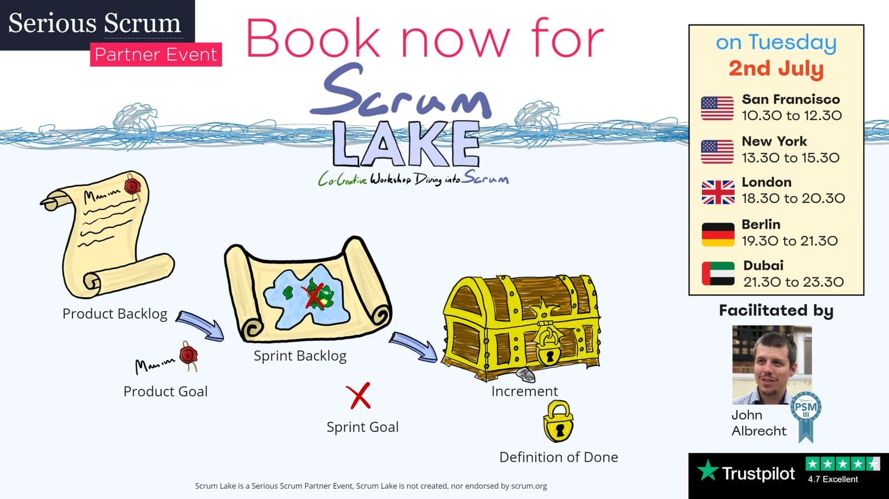

{:class="img-fluid" width="1600" height="900"}

Stories are powerful things. They help us reflect, grow, and learn from others. If you are a Scrum Master, Coach, or Product Owner looking to learn and grow, consider attending the next Scrum Lake workshop. These are Communities of Practice with a difference - a global workshop where you can explore and reflect on your own practice. Scrum Lake provides a supportive environment where you can receive feedback from your peers and collaborate with a diverse and highly engaged group of Scrum Masters and Coaches worldwide.\

Our next workshop is on July 2nd. Book your tickets now at [ScrumLake.com](/book). If you are currently out of work or looking for a new opportunity, please reach out to us for a complimentary ticket.\

Join the conversation and grow your skills with us